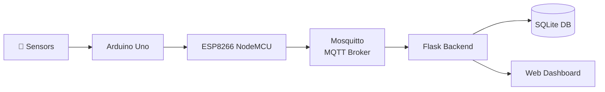

# 🌫️ AQI Smart – Real-Time Air Quality Monitoring System


AQI Smart is a real-time air quality monitoring system built on IoT hardware and a lightweight software stack. Sensor data is collected at the hardware level, transmitted wirelessly over MQTT via ESP8266, processed by a Flask backend, persisted in SQLite, and displayed on a live web dashboard — all running locally without any cloud dependency.

---

## ✨ Features

- Real-time sensor data over MQTT protocol
- Monitors PM2.5, gas levels, temperature, and humidity
- Interactive analytics charts via Chart.js
- Historical data storage in SQLite
- Threshold-based AQI status alerts
- Session history tracking
- Responsive web dashboard UI

---

## 🏗️ System Architecture


<!-- 
**Data Flow:** `Sensors → Arduino Uno → ESP8266 → MQTT Broker → Flask → SQLite → Dashboard` -->

---

## 🔧 Hardware Components

| Component | Role |
|---|---|
| Arduino Uno | Reads and processes all sensor inputs |
| ESP8266 NodeMCU | Wi-Fi module — publishes data to MQTT broker |
| MQ135 Gas Sensor | Detects gas and air pollutant concentration |
| DHT11 Sensor | Measures ambient temperature and humidity |
| PM2.5 Dust Sensor | Measures fine particulate matter (GP2Y1010AU0F) |
| Breadboard | Prototyping and circuit connections |
| Jumper Wires | Component wiring |

**Additional passive components:** 150Ω resistor (dust sensor LED), 220µF capacitor (signal stabilization)

### Hardware Pin Connections

| Sensor | Pin | Arduino Pin |
|---|---|---|
| Dust Sensor VCC | Power | 5V |
| Dust Sensor Vo | Signal | A0 |
| Dust Sensor LED | Control | D2 |
| DHT11 DATA | Signal | D4 |
| MQ135 AO | Analog | A1 |
| Arduino TX | Serial | ESP8266 D6 |

---

## 💻 Software Stack

| Layer | Technology |
|---|---|
| Firmware | Arduino IDE (C++) |
| Wireless Communication | MQTT / Mosquitto Broker |
| Backend | Python, Flask |
| Database | SQLite (built-in with Python) |
| Frontend | HTML, CSS, JavaScript |
| Charts | Chart.js |

---

## 📋 Dashboard Modules

| Module | Description |
|---|---|
| **Dashboard** | Live readings for PM2.5, gas, temperature, humidity + AQI status indicator |
| **Analytics** | Historical bar/line charts for trend analysis |
| **History** | Tabular log of all past sensor readings with timestamps |
| **Alerts** | Threshold-based notifications when air quality is poor |

---

<!-- ## ⚙️ Installation & Setup

### 1. Clone the Repository
```bash
git clone https://github.com/your-username/aqi-dashboard.git
cd aqi-dashboard
```

### 2. Create Virtual Environment
```bash
python -m venv venv

# Windows
venv\Scripts\activate

# Linux/macOS
source venv/bin/activate
```

### 3. Install Dependencies
> No `requirements.txt` currently — install manually:

```bash
pip install flask
pip install paho-mqtt
pip install Werkzeug
```

> `sqlite3` is included with Python — no additional install needed.

### 4. Initialize the Database
```bash
python database.py
```
This creates `aqi.db` and sets up the required table for storing sensor readings.

### 5. Install & Start Mosquitto Broker

Download and install [Mosquitto](https://mosquitto.org/download/).
- During install: check **Install as Service** and **Add to PATH**

Start the broker:
```bash
mosquitto -v
```
> Keep this terminal open — the broker must stay running.

### 6. Configure Network

Both your laptop and the ESP8266 must be on the **same Wi-Fi network or mobile hotspot**.

Find your local IP:
```bash
ipconfig        # Windows
```
Example output:
```
IPv4 Address : 192.168.1.5
```
This IP is used as the MQTT broker address in both the firmware and Flask backend.

### 7. Configure ESP8266 Firmware

In `Esp12E.cpp`, update:
```cpp
const char* ssid = "YOUR_WIFI_NAME";
const char* password = "YOUR_WIFI_PASSWORD";
const char* mqtt_server = "192.168.1.5";  // Your laptop's IP
```
Upload via Arduino IDE to the ESP8266 NodeMCU.

### 8. Configure Flask MQTT Connection

In `app.py`, update:
```python
client.connect("192.168.1.5", 1883, 60)  # Same IP as above
```

### 9. Firewall Configuration (Windows)

If MQTT traffic is blocked, allow the following through Windows Firewall:
- **Python** — Private Networks ✅
- **Mosquitto** — Private Networks ✅

### 10. Start Flask Backend
```bash
python app.py
```
Expected terminal output:
```
MQTT CONNECTED, code: 0
```

### 11. Verify ESP8266 Connection

Open Arduino IDE → Serial Monitor (9600 baud). Expected output:
```
WiFi Connected!
Connecting MQTT... Connected!
```
The ESP8266 will now start publishing data to topic `aqi/data`.

### 12. Open the Dashboard

Visit in your browser:
```
http://localhost:5000
```

--- -->

## 🚀 Startup Sequence

Follow this order every time — sequence matters.

| Step | Action | Why |
|---|---|---|
| 1 | Start Mosquitto Broker | Must be running before any MQTT client connects |
| 2 | Run `python app.py` | Flask subscribes to MQTT on startup |
| 3 | Power on ESP8266 | Connects to broker and starts publishing |
| 4 | Open `http://localhost:5000` | Dashboard pulls live data |

---

## 📡 MQTT Configuration

| Parameter | Value |
|---|---|
| Topic | `aqi/data` |
| Port | `1883` |
| Broker | Mosquitto (local) |
| Protocol | MQTT v3.1.1 |
| Communication | ESP8266 → MQTT → Flask |

**Published payload (JSON):**
```json
{
  "temperature": 36.5,
  "humidity": 35,
  "pm2_5": 450.8,
  "gas": 120
}
```

---

## 🌐 Network Requirements

- ESP8266 and laptop must be on the **same Wi-Fi network or hotspot**
- Mosquitto broker must be **running before Flask starts**
- Firewall must **allow port 1883**
- MQTT broker IP must match in **both** `Esp12E.cpp` and `app.py`

> **Recommended:** Run the Mosquitto broker locally on the same machine as the Flask backend. This gives more reliable communication compared to public MQTT brokers and avoids latency or auth issues.

---

## 🔌 API Endpoint

**`GET /api/data`** — Returns the latest sensor reading from the database.

**Sample Response:**
```json
{
  "time": "2026-05-13 10:30:00",
  "temperature": 36.5,
  "humidity": 35,
  "pm2_5": 450.8,
  "gas": 120
}
```

---

## 📁 Project Structure

```
aqi-dashboard/
│
├── app.py                  # Flask app + MQTT subscriber
├── database.py             # DB initialization
├── aqi.db                  # SQLite database (auto-created)
├── Esp12E.cpp              # ESP8266 firmware (Arduino IDE)
├── .gitignore
├── README.md
│
├── static/
│   ├── style.css
│   └── script.js
│
├── templates/
│   └── index.html          # Dashboard UI
│
└── videos/
    ├── AQI_Monitoring_Sys.mp4
    ├── finaldashboard-result.mkv
    └── variation_in_parameters.mp4
```

---

## 🎥 Working Demo

[](videos/AQI_Monitoring_Sys.mp4)


The demo covers:
- Live sensor data acquisition
- MQTT communication between ESP8266 and Flask
- Real-time dashboard updates
- Database logging
- Analytics and history modules

---

<!-- ## 🖼️ Dashboard Preview

> Screenshots can be added here. Grab a browser capture of each module — Dashboard, Analytics, History, and Alerts — and drop them in the repo root or a dedicated folder.

--- -->

<!-- ## 🧩 Challenges & Solutions

| Challenge | Solution |
|---|---|
| MQTT broker not connecting | Configured `mosquitto.conf` with `listener 1883` and `allow_anonymous true` |
| ESP8266 not reaching broker | Ensured both devices on same network; verified IP with `ipconfig` |
| Real-time sync lag | Used MQTT background thread in Flask to handle incoming messages instantly |
| SQLite write conflicts | Implemented thread-safe connection handling in `app.py` |
| Windows firewall blocking MQTT | Manually allowed Python and Mosquitto on private network |

--- -->

## 🔨 Troubleshooting

**MQTT Not Connecting**
- Confirm Mosquitto is running (`mosquitto -v`)
- Check broker IP matches in both firmware and `app.py`
- Allow port 1883 through firewall

**Dashboard Not Updating**
- Verify Flask is running and shows `MQTT CONNECTED, code: 0`
- Check browser console for JS errors
- Confirm ESP8266 Serial Monitor shows successful MQTT publish

**Database Not Receiving Data**
- Run `python database.py` again to reinitialize
- Check `app.py` for correct DB path and table name

**MQTT rc=-2 Error (ESP8266 cannot reach broker)**
- Broker IP in `Esp12E.cpp` doesn't match your machine's current IP
- Run `ipconfig` again — IP may have changed if you switched networks
- Verify Mosquitto is running and firewall allows port 1883

**ESP8266 Wi-Fi Issues**
- Double-check SSID and password in `Esp12E.cpp`
- Ensure ESP8266 and laptop are on the same network/hotspot
- Re-upload firmware after any config change

---

## 🚀 Future Improvements

- Mobile app (React Native or Flutter)
- Cloud deployment (AWS IoT / Google Cloud IoT)
- GPS-based outdoor AQI mapping
- AI-based AQI prediction from historical data
- Multi-device support for distributed sensor nodes
- Advanced analytics with exportable reports

---

## 📄 License

This project is licensed under the [MIT License](LICENSE.md).

---

> Built as a practical IoT prototype integrating embedded hardware, wireless communication, and web-based visualization. Contributions and feedback are welcome.